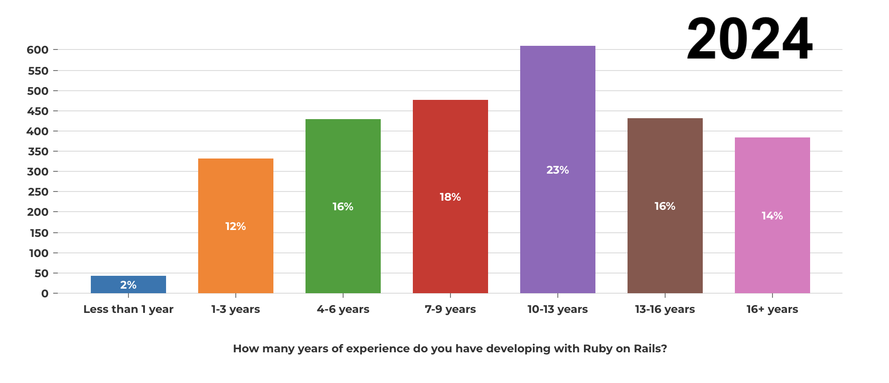
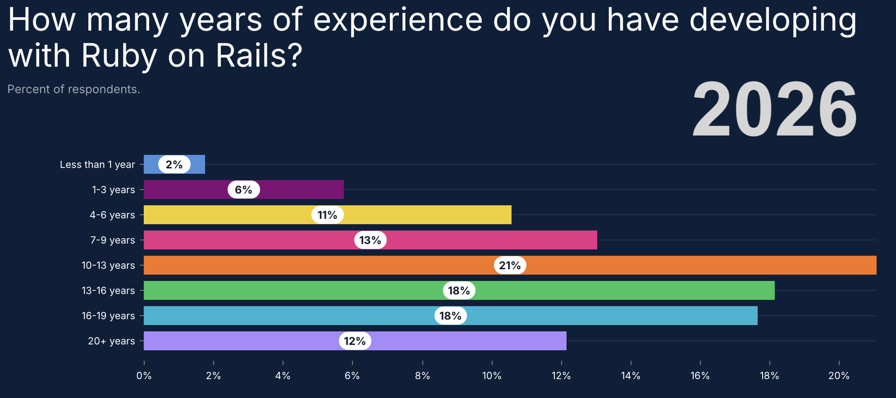
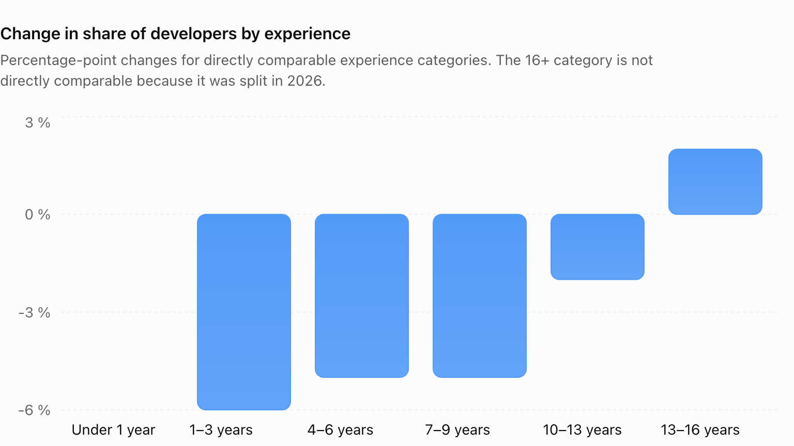
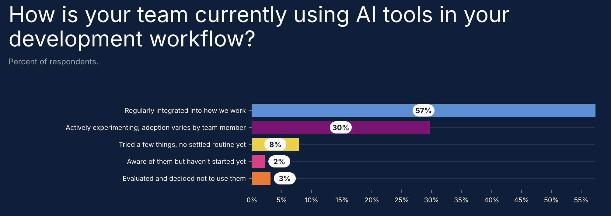
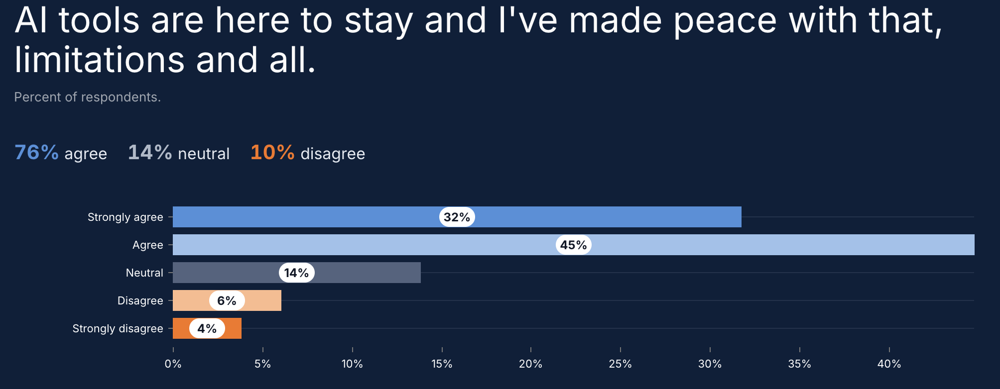

The results of the [2026 Ruby on Rails Community Survey](https://railsdeveloper.com/survey/2026) were published recently. The results overwhelmingly reflect a core developer population that remains committed to the Rails platform, with significant adoption of AI tools.
But we are still sailing on a very leaky boat, with fewer juniors, and an aging senior cohort.

This is all despite the [latest DHH controversy](https://www.reddit.com/r/rails/comments/1woa8r8/dhh_is_completely_crazy/) when he called an end to coding by hand [at Rails World 2026](https://www.youtube.com/watch?v=vDjW_dRyKXY) of course!

When I look back and compare with the [2024 Rails Survey](/2024/09/rails-2024-survey-surprises), it is startling how fast things are changing.
Just considering the demographics:

* 13+ years experience: up from 30% to 48%
* Under 10 years experience: shrunk from 48% to 32%

If we look at the change by experience cohort, the aging & dropping out problem is pretty clear. Perhaps the only good news is that Rails maintains a constant small trickle of new people trying the platform.

## AI Adoption

For those that remain, AI adoption is pretty much universal, with sentiment largely positive.

I suspect that AI tools are as good if not better at generating Ruby and Rails code over most other languages, simply because the community values of open source and test driven development has created an awesome training data set as its legacy.

## Fewer Juniors. More AI. A Tyranny of Seniors?

It makes one wonder about the future we are facing: a few aging seniors overseeing an army of AI agents?

The looming issues are obvious:

* **We have a pipeline problem** Where are the replacements for the seniors coming from when the current cohort shuffle off this mortal coil?
* **We have an innovation dilemma** AI tools are trained on existing technology, and are really good it writing code accordingly. This disincentivizes core innovation, as it degrades agent effectiveness. Coupled with the aging demographics, we get doubly-incentivised to just let the Rails platform stagnate.

This may work out in the short-term. As always, some heroic efforts of individuals will likely carry the community forward.

But are we eventually going to be dealing with an ossified platform, with no-one remaining with the skills or incentive to keep it alive?

The big question is of course what happens with AI.
The most optimistic view is that we'll soon get to something like AGI (at least within the domain of software development), such that:

* there is no longer the need for a skilled developer in the loop
* it is capable of significant platform innovation without skilled developer guidance

Maybe. Personally I do not believe the currently generation of transformer-based large language models will be able to achieve this before they hit fundamental brick-walls. It's all riding on what comes next...
